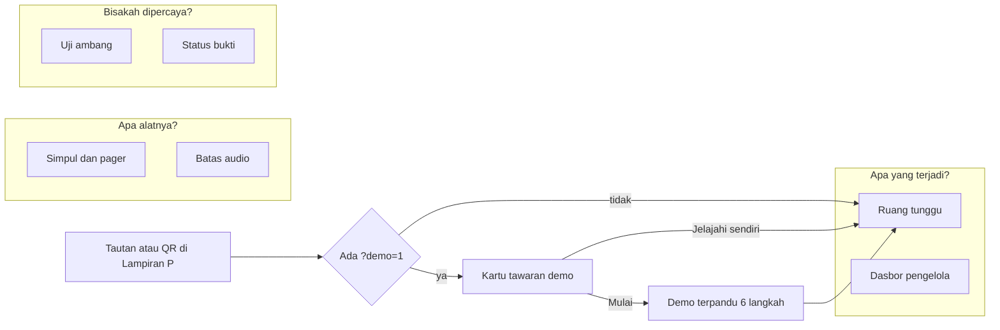
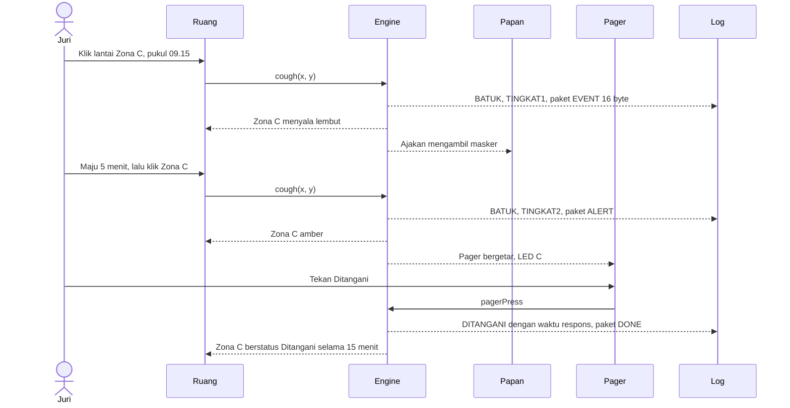
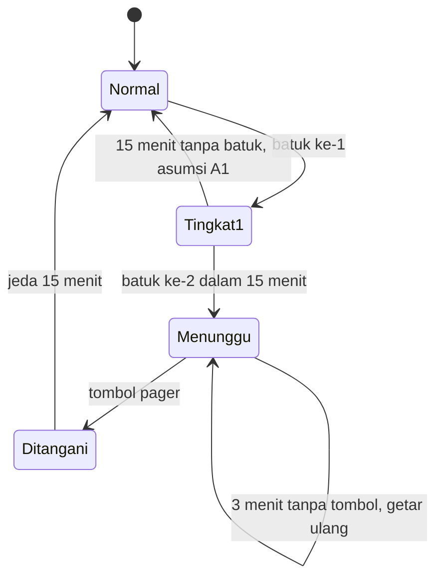

# App Flow Document: SUAR Simulator

Versi 1.0, 7 November 2026. Aturan logika ada di [TRD](TRD.md) subbab 5. Tampilan ada di [Design Brief](DESIGN_BRIEF.md).

## 1. Peta aplikasi

Navigasi sisi kiri mengikuti tiga kelompok pertanyaan tersebut. Lencana SIMULASI selalu tampil. Status simulasi bertahan saat berpindah halaman dan hilang saat muat ulang.

## 2. Pembukaan pertama

1. Halaman `#/` tampil. Kerangka, judul, dan panel muncul lebih dulu, lalu ruang 3D menyusul.
2. Muncul kalimat pembuka dengan angka dan labelnya.
3. Bila tautan memuat `?demo=1`, kartu tawaran muncul: "Lihat SUAR bekerja dalam 1 menit" dengan tombol **Mulai** dan **Jelajahi sendiri**.
4. Tanpa `?demo=1`, tombol mengambang "Demo 1 menit" tetap tersedia di kanan bawah.
5. Pada lebar di bawah 768 px, atau tanpa WebGL, denah 2D menggantikan 3D. Pesan: "Menampilkan denah 2D. Logikanya sama."

## 3. Alur inti: satu kejadian

Tanpa tombol selama 3 menit, pager bergetar lagi dan log mencatat `ESKALASI`.

## 4. Mesin keadaan zona

Status simpul berjalan terpisah: Normal, Terbatas (bising), atau Luring. Saat Terbatas atau Luring, simpul tersebut tidak melapor dan statusnya terlihat. Prinsipnya mengikuti proposal: kegagalan tidak boleh tampak sama dengan kondisi aman.

## 5. Alur per halaman

### 5.1 Ruang tunggu `#/`

**Judul:** "Apa yang terjadi saat seseorang batuk?"

**Kalimat pembuka:** "Ambang lama menangkap **7%** pasien median. Dua tingkat memberi sinyal pada **87%** dan memanggil petugas pada **43%**, dengan **0,73** alarm palsu per jam. Hasil simulasi, belum diukur."

| Aksi pengguna | Hasil |
|---|---|
| Arahkan kursor ke lantai | Tooltip "Zona C · ΔL 5,2 dB", atau "Zona B dan C · ΔL 1,4 dB" |
| Klik lantai | Riak batuk, gelombang ke simpul, titik paket ke koordinator, status berubah |
| Geser lantai | Kamera berputar. Tidak ada batuk |
| Tombol "Batuk di Zona A, B, C, D" | Sama dengan klik lantai pada titik simpul zona |
| Tombol "Percakapan" | Riak abu-abu, tidak ada paket EVENT, penghitung "Percakapan diabaikan" naik |
| Tombol kecepatan dan maju | Jam simulasi berubah |
| Putar skenario pagi | Linimasa berjalan, kontrol manual dikunci sampai selesai atau dihentikan |
| Sakelar "Petugas sibuk" | Skenario memakai cabang eskalasi |
| Pengaturan simpul | Tiap simpul: Normal, Bising, Luring. Pilihan Luring untuk Simpul A dinonaktifkan dengan keterangan |
| Pilih peran | Panel kanan berganti: Pengunjung, Petugas, Pengelola |
| Reset | Status kembali ke 09.00 dan log kosong |

**Panel kanan menurut peran:**

| Peran | Isi panel |
|---|---|
| Pengunjung | Papan informasi dan ajakan masker saat Tingkat 1 |
| Petugas (bawaan) | Pager dengan 4 LED, tombol Ditangani, kartu prosedur empat langkah saat Tingkat 2 |
| Pengelola | Status empat zona, waktu respons terakhir, tautan ke Dasbor |

**Di bawah ruang:** log metadata, lalu kartu angka: jumlah batuk, kejadian Tingkat 2, median respons sesi, dan "Audio keluar: 0 byte (dirancang; menunggu audit)".

### 5.2 Dasbor `#/dasbor`

**Judul:** "Apa yang dilihat pengelola?"

Sumber data dipilih dengan sakelar:

- **Sesi ini** (bawaan). Data dari engine. Sebelum ada kejadian, tampil keadaan kosong: "Belum ada kejadian. Coba batuk di Ruang tunggu." dengan tautan.
- **Contoh sehari.** Data Gambar 19 proposal, berlabel ilustratif.

Bilah atas menulis "SUAR · Dasbor ruang tunggu" dan "192.168.4.1 · tanpa internet (tiruan)". Catatan tetap di bawah: "Hanya hitungan agregat per zona; tanpa audio, wajah, atau identitas."

### 5.3 Simpul dan pager `#/alat`

**Judul:** "Apa isi alatnya?"

**Kalimat pembuka:** "SUAR adalah alat fisik. Satu simpul berisi lima lapis dan biaya komponennya sekitar **Rp565 ribu**. Render konsep, bukan foto purwarupa."

| Aksi | Hasil |
|---|---|
| Tombol "Buka simpul" | Lapisan terpisah secara vertikal, tombol berganti menjadi "Tutup simpul" |
| Klik titik bernomor | Panel kanan menampilkan fungsi dan harga komponen. Klik lagi menutup |
| Sakelar "Simpul" dan "Pager" | Model berganti |
| Reset tampilan | Kamera kembali |

Tanpa WebGL, halaman menampilkan `reference/figures/f12_casing.png` beserta daftar komponen yang sama.

### 5.4 Batas audio `#/batas-audio`

**Judul:** "Apa yang keluar dari alat?"

**Kalimat pembuka:** "Audio hidup di memori selama satu detik, lalu ditimpa. Yang keluar hanya paket **16 byte**. Rancangan ini menunggu audit."

| Aksi | Hasil |
|---|---|
| Tombol Percakapan | Pipa berjalan, keputusan "bukan batuk", 0 paket, memori ditimpa |
| Tombol Batuk | Pipa berjalan, keputusan "batuk", satu paket muncul |
| Arahkan kursor ke byte | Medan terkait disorot pada tabel, dan sebaliknya |
| Paket terakhir | Berasal dari `state.packets`. Bila kosong, tampil paket contoh berlabel contoh |

Keterangan tetap: "Visual ini ilustratif. Simulator tidak memiliki audio dan tidak meminta izin mikrofon."

### 5.5 Uji ambang `#/ambang`

**Judul:** "Kenapa dua tingkat?"

| Aksi | Hasil |
|---|---|
| Pilih preset "Abstrak ≥3/10" | Tangkapan 7%, tanda "sesuai proposal" |
| Pilih preset "Proposal ≥2/15" | Tangkapan 43%, alarm palsu 0,94 per jam, tanda "sesuai proposal" |
| Pilih preset "1 batuk saja" | Tangkapan 87%, alarm palsu 4,12 per jam, melewati batas ≤1 |
| Pilih preset "Mode bising ≥3/15" | Untuk ruang yang melewati batas alarm. Seluruh sebaran pasien: tangkapan 26%, alarm palsu 0,09 per jam dengan jeda |
| Ubah N atau T | Titik pada grafik berpindah, hasil berubah |
| Ubah asumsi | Tanda berganti menjadi "tersimulasi di peramban" |
| Pilih frekuensi Q1, Median, Q3 | Nilai 1,2; 2,3; 4,1 batuk per jam |
| Kembalikan nilai bawaan | Semua kontrol kembali ke parameter proposal |

Kalimat pembuka diperbarui langsung dari nilai yang tampil. Catatan tetap: "Hasil simulasi, bukan hasil uji. Poisson mengabaikan batuk yang datang berkelompok."

### 5.6 Status bukti `#/bukti`

**Judul:** "Seberapa kuat buktinya?"

**Kalimat pembuka:** "Simulator ini memperagakan rancangan. Simulator ini tidak membuktikan bahwa alat mampu mendengar batuk."

Halaman baca-saja berisi: tabel janji, empat gerbang uji, legenda status, daftar asumsi A1 sampai A4, A6, dan A7, dan rujukan bab proposal.

## 6. Demo terpandu

Mengikuti rencana peragaan booth pada Gambar 29 proposal. Layar meredup, elemen target dibingkai, kartu langkah tampil di sampingnya. Status direset di awal demo.

| Langkah | Target `data-tour` | Isi kartu | Lanjut saat |
|---|---|---|---|
| 1 | tanpa target | "SUAR menandai zona, bukan orang. Coba alurnya dalam satu menit." | Tombol Lanjut |
| 2 | `speech-c` | "Percakapan di dekat Zona C. Perhatikan: tidak terjadi apa-apa." | Tombol ditekan |
| 3 | `cough-c` | "Satu batuk. Lampu zona menyala lembut dan papan mengajak mengambil masker." | Tombol ditekan |
| 4 | `cough-c` | "Tujuh menit kemudian, batuk kedua. Dua batuk dalam 15 menit memanggil petugas." Jam otomatis maju 7 menit | Tombol ditekan |
| 5 | `pager-done` | "Pager bergetar. Petugas menawarkan masker, lalu menekan tombol." | Tombol ditekan |
| 6 | `log` | "Hanya zona, waktu, level, dan status yang tercatat. Ini simulasi; uji nyatanya dijadwalkan pada G1 sampai G4." | Tombol Selesai |

Setelah selesai, kartu menawarkan tiga tautan: Uji ambang, Simpul dan pager, Status bukti.

Keluar dari demo dengan tombol tutup atau Esc. Status terakhir tetap ada. Jika target tidak terlihat, halaman menggulir ke target. Jika tetap tidak terlihat, kartu tampil di tengah.

## 7. Keadaan khusus

| Keadaan | Perilaku |
|---|---|
| WebGL gagal | Denah 2D, tanpa pesan galat teknis |
| Tab tidak terlihat | Jam simulasi berhenti dan berlanjut saat kembali |
| `prefers-reduced-motion` | Tanpa riak dan getar animasi. Status berubah langsung, dengan label teks |
| Dua zona aktif | Pager menyalakan dua LED, kelompok tertua berkedip. Tombol menutup kelompok tertua |
| Semua simpul terdekat tidak aktif | Log `STATUS_SIMPUL`, toast "Batuk ini tidak terdengar: Simpul C luring." |
| Muat ulang | Status kembali ke awal, tanpa peringatan |
| Hash tidak dikenal | Kembali ke `#/` |

## 8. Keyboard dan pembaca layar

| Tombol | Fungsi |
|---|---|
| Tab | Berpindah antarkontrol sesuai urutan baca |
| Enter atau Spasi | Menjalankan kontrol |
| Esc | Menutup demo, tooltip, dan panel |
| Tombol panah | Mengubah penggeser |

Status zona dan pager diumumkan melalui satu wilayah `aria-live="polite"`, contoh: "Zona C, Tingkat 2. Pager bergetar." Kanvas 3D memiliki `aria-label`, dan seluruh aksinya tersedia lewat tombol biasa.

## 9. Jalur latihan pitching

1. Buka `#/`, tekan Reset.
2. Putar skenario pagi: 45 sampai 60 detik pada kecepatan bawaan skenario.
3. Buka Uji ambang, pilih preset Abstrak, lalu preset Proposal.
4. Buka Simpul dan pager, tekan Buka simpul.
5. Tutup di Status bukti dengan kalimat wajib.
